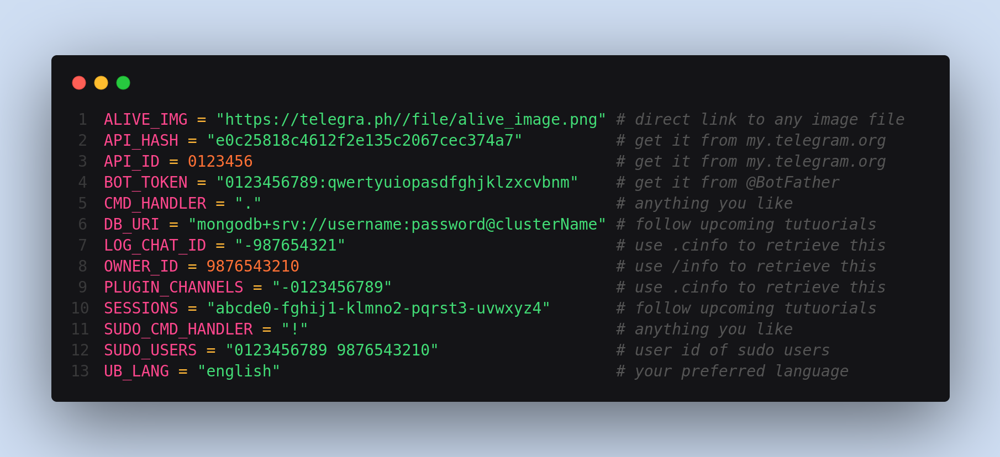

<h1 align="center"><b>Altruix | UserBot</b></h1>
<p align="center"><br></p>

#### **Altruix** | A high-performance, modular Telegram UserBot and Assistant Bot framework built with **Telethon** and modern asynchronous Python.
<br>

# Deploying To Different Platforms
> - For deploying [Locally](#deploy-locally)

<br>

# Official Support/Updates
> - Join the official **Updates** Channel
>    <a href="https://t.me/AltruiXUB"></a>
> - Join the official **Support** Chat
>    <a href="https://t.me/AltruixChat"></a>

<br>

## Deploy Locally

To deploy Altruix on your Linux server, PC, or Termux:

```bash
git clone https://github.com/Altruix/Altruix
cd Altruix
cp example.env .env
# Set API_ID and API_HASH in .env. Add BOT_TOKEN for the assistant bot,
# and a StringSession in SESSIONS to enable userbot features.
python -m pip install -e .
python -m Main
```

## String Session

Altruix uses **Telethon StringSessions**. You can generate one in two ways:

1. **Terminal Generator:**
   ```bash
   python -m Main.scripts.session_gen
   ```
2. **Interactive Assistant Bot:**
   Run the assistant bot and use `/add` or `/session` to securely generate and register sessions directly through Telegram.


## Required Variables

> Following are the required variables for the proper working of userbot, note down these somewhere for easier access so that you may use them in future:

<details close>

  > These are used to communicate with the telegram servers. You can get you your `API_HASH` and `API_ID` from [Telegram](my.telegram.com) by following the given steps:
  > - Go to [my.telegram.com](my.telegram.com).
  > - Login via adding your mobile number in the international format i.e `+00 9876543210`.
  > - You will receive an `11` character alphanumeric code via the Telegram App. Input this code into the input field and proceed.
  > - Now click on [API development tools](https://my.telegram.org/apps).
  > - Here you may add an `App title` and a `Short name` for it (they can be anything). Note down the `APP api_id` and `APP api_hash` for future use. Scroll down to the end of the page and click on `Save changes` button.

<summary> API_ID </summary>
</details>

<details close>

  > These are used to communicate with the telegram servers. You can get you your `API_HASH` and `API_ID` from [Telegram](my.telegram.com) by following the given steps:
  > - Go to [my.telegram.com](my.telegram.com).
  > - Login via adding your mobile number in the international format i.e `+00 9876543210`.
  > - You will receive an `11` character alphanumeric code via the Telegram App. Input this code into the input field and proceed.
  > - Now click on [API development tools](https://my.telegram.org/apps).
  > - Here you may add an `App title` and a `Short name` for it (they can be anything). Note down the `APP api_id` and `APP api_hash` for future use. Scroll down to the end of the page and click on `Save changes` button.

<summary> API_HASH </summary>
</details>

<details close>

  > It's used to control your bot's actions etc. You can get your `BOT_TOKEN` for your bot by following the given steps:
  > - Go to [@BotFather](t.me/BotFather).
  > - Do `/start` -> `/newbot`
  > - You'll be prompted to choose a name for your bot (it can be anything).
  > - You'll be prompted to choose a username name for your bot (it can be anything but should end with suffix `bot`).
  > - Your bot with the above details will be made! And a message containg your bots api token will also be sent.

<summary> BOT_TOKEN </summary>
</details>

<details close>

  > Optional. When left empty, Altruix stores settings in the local `local_db.json` file.
  > Set `DB_URI` to a MongoDB connection string to use MongoDB, and optionally set `DB_NAME` (defaults to `Altruix`).

<summary> DB_URI </summary>
</details>

<details close>

  > It's used to tell your bot who is the owner of this bot and whom commands it should fulfil. Only the person with this ID can give the bot command to add more sessions to the database via `/add`.
  > - Go to [@MissRose_Bot](t.me/MissRose_Bot).
  > - Do `/start` -> `/info`
  > - You'll receive a message containing your ID.

<summary> OWNER_ID </summary>
</details>

<br>

## .env

<details close>
<p align="center"><br></p>
<summary> An example of how your `.env` file should look like: </summary>
</details>

## Altruix Package Manager (APM) & Custom Plugins

> 📖 **Developer Guide:** For comprehensive instructions on creating plugins, decorators, database integration, and flags, check out the [Full Plugin Developer Guide](docs/PLUGIN_GUIDE.md).

Altruix includes a built-in package manager (**APM**) that allows you to install, update, and manage third-party or custom plugins directly from GitHub repositories without modifying the core codebase.

### Installing Plugins via APM

You can install plugins directly through your Telegram client using the `.apm_install` command:

* **Install from a GitHub Repository:**
  ```text
  .apm_install https://github.com/username/my-altruix-plugin
  ```
* **Install and persist across bot restarts:**
  ```text
  .apm_install -ios https://github.com/username/my-altruix-plugin
  ```
* **List installed external plugins:**
  ```text
  .apm_list
  ```
* **Uninstall a plugin:**
  ```text
  .apm_rem my-altruix-plugin
  ```

---

### How to Create a Plugin Repository for APM

To create your own plugin repository that can be installed by anyone using Altruix APM:

#### 1. Repository Layout
Create a public GitHub repository (e.g., `https://github.com/username/my-altruix-plugin`) with the following layout:

```text
my-altruix-plugin/
├── plugin.json         # Plugin manifest (recommended)
├── custom_tool.py      # Your plugin script
└── README.md
```

#### 2. Plugin Manifest (`plugin.json`)
Include a `plugin.json` in the root of your repository. APM reads this to verify metadata and automatically pip-install any required dependencies:

```json
{
  "name": "my_custom_plugin",
  "version": "1.0.0",
  "description": "Custom utility commands for Altruix",
  "author": "YourName",
  "entry": "custom_tool.py",
  "dependencies": ["httpx", "pillow"]
}
```

* **`name`**: Unique identifier for your plugin.
* **`entry`**: Specific `.py` entry file (if omitted, all `.py` files in the repository are loaded).
* **`dependencies`**: Python packages that APM will automatically install before loading the plugin.

#### 3. Writing Plugin Code
Write your plugin using standard Altruix decorators:

```python
from Main import Altruix
from Main.core.types.client import AltruixTelegramClient as Client
from Main.core.types.message import Message

@Altruix.register_on_cmd(
    ["mycmd"],
    cmd_help={
        "help": "Does something awesome",
        "example": "mycmd",
    },
)
async def my_command(c: Client, m: Message):
    msg = await m.handle_message("Processing...")
    await msg.edit_msg("Hello from my external APM plugin!")
```

<br>

## About the Repo

> Currently Running Stable version of Altruix.
> [](#)
> Is our project under active maintenance?
> [](https://github.com/Altruix/Altruix/graphs/commit-activity)
> Developers aka Contributors for the Project.
> [](https://github.com/Altruix/Altruix/graphs/contributors)

## Credits

> - <a href="https://www.github.com/EverythingSuckz">    EverythingSuckz    </a>
> - <a href="https://www.github.com/StarkGang">          StarkGang          </a>
> - <a href="https://www.github.com/BilakshanP">         BilakshanP         </a>
> - <a href="https://www.github.com/Reeshuxd">           Reeshuxd           </a>
> - <a href="https://www.github.com/Rohith-Sreedharan">       Rohithaditya       </a>
> - <a href="https://www.github.com/StarkBotIndustries"> StarkBotIndustries </a>
> - <a href="https://www.github.com/sohag02">            sohag02            </a>
> - <a href="https://www.github.com/SHRE-YANSH">         SHRE-YANSH         </a>
> - <a href="https://www.github.com/lostb053">           lostb053           </a>
> - <a href="https://www.github.com/Nksama">             Nksama             </a>
> - <a href="https://www.github.com/Crackexy">           Crackexy           </a>
> - <a href="https://www.github.com/anonyindian">        anonyindian        </a>
> - <a href="https://www.github.com/N0BLEWOLF">          N0BLEWOLF          </a>
> - <a href="https://www.github.com/ramanveerji">        ramanveerji        </a>
> - <a href="https://www.github.com/swatv3nub ">         swatv3nub          </a>

<p align="center">
  
</p>
